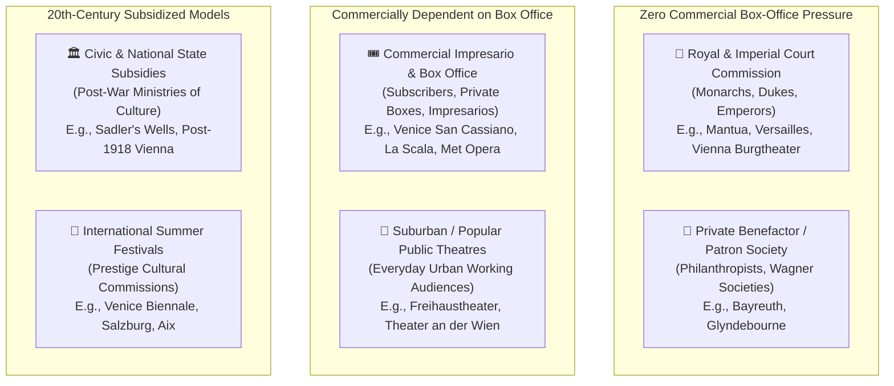

# Historical Research, Curation Guide & World Music-Drama Traditions

> **The World of Opera Cartography Project**  
> *Permanent Historical Reference, Curatorial Standards & Comparative Theatrical Research*

---

## Table of Contents
1. [Curatorial Principles: Inclusion vs. Exclusion](#1-curatorial-principles-inclusion-vs-exclusion)
   - [The American "Opera House" Euphemism (Exclusion Criteria)](#the-american-opera-house-euphemism-exclusion-criteria)
   - [Justification of Global Outposts & UNESCO Ensembles](#justification-of-global-outposts--unesco-ensembles)
2. [Master Canon of Operas & Premiere Locations](#2-master-canon-of-operas--premiere-locations)
   - [Early Baroque & The Birth of Opera (1597–1700)](#early-baroque--the-birth-of-opera-15971700)
   - [High Baroque & Classical Reform (1700–1780)](#high-baroque--classical-reform-17001780)
   - [The Viennese Classical Golden Age (1780–1810)](#the-viennese-classical-golden-age-17801810)
   - [Italian Bel Canto Era (1810–1850)](#italian-bel-canto-era-18101850)
   - [The Romantic High Epoch: Verdi & Wagner (1840–1890)](#the-romantic-high-epoch-verdi--wagner-18401890)
   - [French Grand Opera & Opéra-Comique](#french-grand-opera--opéra-comique)
   - [Russian National School (1830–1900)](#russian-national-school-18301900)
   - [Late Romanticism, Verismo & Puccini (1890–1926)](#late-romanticism-verismo--puccini-18901926)
   - [Modernism & 20th-Century Masterworks (1900–1980)](#modernism--20th-century-masterworks-19001980)
   - [Contemporary & Late-20th-Century Operas (1970–Present)](#contemporary--late-20th-century-operas-1970present)
3. [Heritage Succession: Lost Sites & Direct Successor Venues](#3-heritage-succession-lost-sites--direct-successor-venues)
4. [Socio-Economic Patronage Models: An Analytical Matrix](#4-socio-economic-patronage-models-an-analytical-matrix)
5. [Comparative World Traditions: Non-Western "Total Theatre"](#5-comparative-world-traditions-non-western-total-theatre)
   - [The Ancient Greek Archetype: Mother of Western Opera](#the-ancient-greek-archetype-mother-of-western-opera)
   - [China: Xiqu, Kunqu & Peking Opera (Jingju)](#china-xiqu-kunqu--peking-opera-jingju)
   - [Japan: Kabuki, Noh & Theatrical Mechanical Innovation](#japan-kabuki-noh--theatrical-mechanical-innovation)
   - [The Islamic World & Persia: Ta'zieh & Mugham Opera](#the-islamic-world--persia-tazieh--mugham-opera)
   - [India: Natya Shastra, Kathakali, Yakshagana & Parsi Theatre](#india-natya-shastra-kathakali-yakshagana--parsi-theatre)
   - [Comparative Matrix: Western Opera vs. World Total Theatre](#comparative-matrix-western-opera-vs-world-total-theatre)
6. [Future Expansion Architecture](#6-future-expansion-architecture)

---

## 1. Curatorial Principles: Inclusion vs. Exclusion

### The American "Opera House" Euphemism (Exclusion Criteria)
Throughout late-19th-century and early-20th-century North America, hundreds of towns and mining camps erected multi-purpose civic halls, second-floor storefront auditoriums, and vaudeville houses that were officially named **"Opera Houses"**. 

#### Why They Were Named "Opera Houses"
In 19th-century Protestant America, the word **"Theatre"** was widely perceived by religious communities as sinful, licentious, and morally disreputable—associated with burlesque, alcohol consumption, prostitution, and low melodrama. 
Conversely, **"Opera"** was viewed as prestigious, refined, European, and morally unimpeachable high art. Calling a venue the *"Podunk Opera House"* allowed municipal leaders and entrepreneurs to bypass local religious censorship and obtain municipal building permits.

#### Exclusion Standard for this Cartography
Almost none of these municipal venues ever staged legitimate grand opera. They hosted traveling minstrel shows, temperance lectures, boxing matches, high school graduations, vaudeville acts, and later silent motion pictures.
* **Strict Exclusion Rule:** Any historic American venue that was an "Opera House" in name only and never housed a resident professional opera company, never staged recognized grand opera repertory with orchestra, and was never an established stop on authentic opera touring circuits is excluded from this Atlas.
* **Exceptions Retained:** Authentic historic opera houses in North America that legitimately produced grand opera or served as genuine cultural epicenters for lyric theatre (e.g., **Central City Opera House** in Colorado [est. 1878, continuously producing opera since 1932], **Piper's Opera House** in Virginia City, Nevada [host to Emma Nevada and touring opera troupes], and established regional houses).

---

### Justification of Global Outposts & UNESCO Ensembles
Users often wonder why certain seemingly remote or non-European theatres are included alongside La Scala, Vienna, or the Met. These venues are included under strict historical and cultural justification:

| Venue | Location | Historical Justification & UNESCO Status |
| :--- | :--- | :--- |
| **Teatro Dom Pedro V** | Macau, China | Built in 1860 as the first Western-style theatre in East Asia. Hosted the **Asian continental premiere of Puccini's *Madama Butterfly***. Inscribed on the **UNESCO World Heritage List** as a core anchor of the *Historic Centre of Macao*. |
| **Teatro Amazonas** | Manaus, Brazil | Inaugurated in 1896 in the heart of the Amazon basin during the Rubber Boom. Constructed with Carrara marble, Alsatian roof tiles, and Murano glass. Hosted Enrico Caruso, legendary Italian touring troupes, and the contemporary *Festival Amazonas de Ópera*. |
| **Gaiety Theatre** | Shimla, India | Opened in 1887 in the Himalayan foothills; the historic British Raj summer capital. Hosted European operetta, light opera, and Western vocal concerts for the colonial viceregal court. Masterpiece of Victorian Neo-Gothic timber architecture. |
| **Khedivial Opera House / Cairo Opera House** | Cairo, Egypt | Built in 1869 by Khedive Ismail Pasha to celebrate the Suez Canal; site of the world premiere of Verdi’s *Aida* (1871). The primary lyric institution of Africa and the Arab world. |
| **Teatro Colón** | Buenos Aires, Argentina | Inaugurated in 1908; acoustically ranked among the top five halls on Earth. The undisputed historic temple of opera in the Southern Hemisphere, hosting Toscanini, Callas, Caruso, and Pavarotti. |
| **Teatro Solís** | Montevideo, Uruguay | Inaugurated in 1856; the oldest active major opera house in South America. Hosted the world's greatest Bel Canto and Verismo legends throughout the 19th and 20th centuries. |
| **Roman Theatres (Verona, Orange, Taormina, Baalbek, Jerash)** | Mediterranean & Levant | Ancient classical stone amphitheatres from Antiquity (1st c. BC – 2nd c. AD) actively repurposed as landmark summer festival stages for grand opera. |

---

### Rigorous Premiere Classification Standards (Sanity Standards)

A fundamental scholarly principle of this cartography is that **"World Premiere"** is strictly reserved for the **first performance in world history** of a musical composition. Other milestones must never be conflated with world premieres:

| Badge Type | Definition & Scholarly Criteria | Representative Examples |
| :--- | :--- | :--- |
| **`WORLD_PREMIERE`** | The true, first performance anywhere on Earth of the composition. | Mozart's *Don Giovanni* (Prague 1787); Verdi's *Aida* (Cairo 1871); Puccini's *Turandot* (La Scala 1926); Berg's *Wozzeck* (Berlin 1925). |
| **`CONTINENTAL_PREMIERE`** | The first performance of a work on a major continent outside its origin. | Puccini's *Madama Butterfly* (Asian Premiere: Macau 1910); Alma Deutscher's *Cinderella* (American Premiere: San José 2017). |
| **`NATIONAL_PREMIERE`** | The first performance of a work within a sovereign nation. | George Enescu's *Oedipe* (Romanian National Premiere: Bucharest 1958); Shostakovich's *Katerina Ismailova* (Bulgarian Premiere: Ruse 1965). |
| **`INAUGURAL_STAGING`** | The gala or opening opera that inaugurated a newly constructed theatre or hall. | Gounod's *Faust* inaugurating the National Theatre of Costa Rica (1897); Verdi's *Aida* inaugurating the National Theatre of Panama (1908); Plácido Domingo Gala opening Bahrain National Theatre (2012). |
| **`HISTORIC_STAGING`** | A landmark festival production, historic revival, or cycle. | Mozart series inaugurating Al Bustan Festival in post-war Lebanon (1994); Perm Theatre's complete Tchaikovsky cycle (1969); Ludwig II's private Wagner performances at Cuvilliés Munich (1884). |

---

## 2. Master Canon of Operas & Premiere Locations

This canonical register tracks the world premieres of the central operatic repertoire, documenting the original venue, premiere date, conductor, patronage model, and historical context.

### Early Baroque & The Birth of Opera (1597–1700)

| Composer | Opera | Year | Premiere Venue | City | Conductor / Creators | Patronage Model | Commission Context & Significance |
| :--- | :--- | :--- | :--- | :--- | :--- | :--- | :--- |
| **Jacopo Peri** | *Dafne* | 1597 | Palazzo Corsi | Florence, Italy | Jacopo Peri (lost score) | `PRIVATE_BENEFACTOR` | Earliest known work that by modern terms can be considered an opera; staged by the Florentine Camerata. |
| **Jacopo Peri** | *Euridice* | 1600 | Palazzo Pitti | Florence, Italy | Jacopo Peri | `ROYAL_COURT` | Earliest surviving complete opera; composed for the royal wedding of King Henry IV of France and Marie de' Medici. |
| **Claudio Monteverdi** | *L'Orfeo* | 1607 | Palazzo Ducale (Accademia degli Invaghiti) | Mantua, Italy | Claudio Monteverdi | `ROYAL_COURT` | Commissioned by Prince Francesco Gonzaga for the Mantuan court carnival; universally recognized as the foundational operatic masterpiece. Zero box-office pressure. |
| **Claudio Monteverdi** | *L'Arianna* | 1608 | Palazzo Ducale | Mantua, Italy | Claudio Monteverdi | `ROYAL_COURT` | Written for the royal wedding of Francesco Gonzaga and Margherita of Savoy; only the legendary *Lamento d'Arianna* survives. |
| **Francesco Manelli** | *L'Andromeda* | 1637 | Teatro San Cassiano | Venice, Italy | Francesco Manelli | `COMMERCIAL_IMPRESARIO` | Historic inaugural opera that opened the world's first public commercial ticket-paying opera house, transforming opera from private court divertissement to public commerce. |
| **Francesco Cavalli** | *Le nozze di Teti e di Peleo* | 1639 | Teatro San Cassiano | Venice, Italy | Francesco Cavalli | `COMMERCIAL_IMPRESARIO` | Earliest surviving Venetian public opera score; adapted for small commercial orchestras and popular public tastes. |
| **Claudio Monteverdi** | *Il ritorno d'Ulisse in patria* | 1640 | Teatro San Cassiano | Venice, Italy | Claudio Monteverdi | `COMMERCIAL_IMPRESARIO` | Monteverdi's triumphant entry into public commercial opera after 30 years in court service. |
| **Claudio Monteverdi** | *L'incoronazione di Poppea* | 1642 | Teatro Santi Giovanni e Paolo | Venice, Italy | Claudio Monteverdi | `COMMERCIAL_IMPRESARIO` | First opera based on historical characters rather than classical mythology; written for the public Venetian Carnival season. |
| **Henry Purcell** | *Dido and Aeneas* | 1689 | Josias Priest's Boarding School | Chelsea, London, UK | Henry Purcell | `PRIVATE_BENEFACTOR` | England’s earliest operatic masterpiece; written for an intimate chamber ensemble of young women. |

---

### High Baroque & Classical Reform (1700–1780)

| Composer | Opera | Year | Premiere Venue | City | Conductor / Creators | Patronage Model | Commission Context & Significance |
| :--- | :--- | :--- | :--- | :--- | :--- | :--- | :--- |
| **G. F. Handel** | *Rinaldo* | 1711 | Queen's Theatre (Haymarket) | London, UK | George Frideric Handel | `COMMERCIAL_IMPRESARIO` | First Italian-language opera composed specifically for the commercial London stage; sensational stage machinery (live sparrows). |
| **G. F. Handel** | *Giulio Cesare in Egitto* | 1724 | King's Theatre (Haymarket) | London, UK | George Frideric Handel | `COMMERCIAL_IMPRESARIO` | Produced by the Royal Academy of Music (commercial shareholder company backed by King George I and noble subscribers). |
| **G. B. Pergolesi** | *La serva padrona* | 1733 | Teatro di San Bartolomeo | Naples, Italy | G. B. Pergolesi | `ROYAL_COURT` | Origin of *opera buffa*; written as an intimate intermezzo for Emperor Charles VI’s birthday; later sparked the *Querelle des Bouffons* in Paris. |
| **Jean-Philippe Rameau** | *Hippolyte et Aricie* | 1733 | Académie Royale de Musique (Palais-Royal) | Paris, France | J.-P. Rameau | `ROYAL_COURT` | Revolutionized French Tragédie en musique with complex chromatic harmony; sparked fierce battles between "Lullystes" and "Ramistes". |
| **C. W. Gluck** | *Orfeo ed Euridice* | 1762 | Altes Burgtheater am Michaelerplatz | Vienna, Austria | Christoph Willibald Gluck | `ROYAL_COURT` | Historic launch of Gluck's "Reform Opera", stripping away empty vocal bravura to serve dramatic integrity. Commissioned by Count Durazzo for Emperor Francis I. |
| **C. W. Gluck** | *Alceste* | 1767 | Altes Burgtheater am Michaelerplatz | Vienna, Austria | Christoph Willibald Gluck | `ROYAL_COURT` | Famous preface declaring that music must serve poetry; commissioned for the Habsburg Imperial Court. |

---

### The Viennese Classical Golden Age (1780–1810)

| Composer | Opera | Year | Premiere Venue | City | Conductor / Creators | Patronage Model | Commission Context & Significance |
| :--- | :--- | :--- | :--- | :--- | :--- | :--- | :--- |
| **W. A. Mozart** | *Idomeneo* | 1781 | Cuvilliés Theatre (Residenz) | Munich, Germany | W. A. Mozart | `ROYAL_COURT` | Commissioned by Prince-Elector Karl Theodor for the Munich Carnival. Full electoral court funding with Europe's finest orchestra. |
| **W. A. Mozart** | *Die Entführung aus dem Serail* | 1782 | Altes Burgtheater am Michaelerplatz | Vienna, Austria | W. A. Mozart | `ROYAL_COURT` | Commissioned by Emperor Joseph II for his *Nationalsingspiel* project, elevating German-language comic opera. |
| **W. A. Mozart** | *Le nozze di Figaro* | 1786 | Altes Burgtheater am Michaelerplatz | Vienna, Austria | W. A. Mozart | `ROYAL_COURT` | Commissioned by Emperor Joseph II. Da Ponte and Mozart softened Beaumarchais' anti-aristocratic satire to pass court censors. |
| **W. A. Mozart** | *Don Giovanni* | 1787 | Estates Theatre (Stavovské divadlo) | Prague, Czechia | W. A. Mozart | `COMMERCIAL_IMPRESARIO` | Commissioned by Italian impresario Pasquale Bondini following Prague's ecstatic reception of Figaro: *"Meine Prager verstehen mich"*. |
| **W. A. Mozart** | *Così fan tutte* | 1790 | Altes Burgtheater am Michaelerplatz | Vienna, Austria | W. A. Mozart | `ROYAL_COURT` | Commissioned by Emperor Joseph II following successful Figaro court revivals. |
| **W. A. Mozart** | *La clemenza di Tito* | 1791 | Estates Theatre | Prague, Czechia | W. A. Mozart | `ROYAL_COURT` | Commissioned by the Bohemian Estates for the coronation of Emperor Leopold II as King of Bohemia. |
| **W. A. Mozart** | *Die Zauberflöte* | 1791 | Freihaustheater auf der Wieden | Vienna, Austria | W. A. Mozart | `SUBURBAN_POPULAR` | Commissioned and produced by actor-impresario Emanuel Schikaneder for his popular suburban theatre troupe. Commercial hit blending fairy-tale comedy with Masonic philosophy. Succeeded by Theater an der Wien in 1801. |
| **L. van Beethoven** | *Fidelio* | 1805 | Theater an der Wien | Vienna, Austria | Ignaz von Seyfried | `COMMERCIAL_IMPRESARIO` | Beethoven’s sole opera; commissioned by Baron Peter von Braun and Schikaneder. Premiered under French military occupation of Vienna. |

---

### Italian Bel Canto Era (1810–1850)

| Composer | Opera | Year | Premiere Venue | City | Conductor / Creators | Patronage Model | Commission Context & Significance |
| :--- | :--- | :--- | :--- | :--- | :--- | :--- | :--- |
| **Gioachino Rossini** | *Tancredi* | 1813 | Teatro La Fenice | Venice, Italy | Gioachino Rossini | `COMMERCIAL_IMPRESARIO` | Rossini's international breakthrough at age 20; introduced the hit aria *"Di tanti palpiti"*. |
| **Gioachino Rossini** | *Il barbiere di Siviglia* | 1816 | Teatro Argentina | Rome, Italy | Gioachino Rossini | `COMMERCIAL_IMPRESARIO` | Commissioned by Duke Francesco Sforza-Cesarini; stormy opening night due to rival Paisiello factions, followed by immortal success. |
| **Gioachino Rossini** | *La Cenerentola* | 1817 | Teatro Valle | Rome, Italy | Gioachino Rossini | `COMMERCIAL_IMPRESARIO` | Composed in just three weeks for the Roman carnival season. |
| **Gioachino Rossini** | *Mosè in Egitto* | 1818 | Teatro di San Carlo | Naples, Italy | Gioachino Rossini | `COMMERCIAL_IMPRESARIO` | Commissioned by legendary impresario Domenico Barbaja during Rossini's directorship of the Royal Neapolitan Theatres. |
| **Gioachino Rossini** | *Semiramide* | 1823 | Teatro La Fenice | Venice, Italy | Gioachino Rossini | `COMMERCIAL_IMPRESARIO` | Rossini's tragic Italian farewell before relocating to Paris. |
| **Vincenzo Bellini** | *I Capuleti e i Montecchi* | 1830 | Teatro La Fenice | Venice, Italy | Gaetano Mares | `COMMERCIAL_IMPRESARIO` | Emergency commission by La Fenice after Giovanni Pacini defaulted; composed in 45 days. |
| **Vincenzo Bellini** | *La sonnambula* | 1831 | Teatro Carcano | Milan, Italy | Alessandro Rolla | `COMMERCIAL_IMPRESARIO` | Commissioned by Milanese aristocratic syndicate backed by the Duke of Litta. |
| **Vincenzo Bellini** | *Norma* | 1831 | Teatro alla Scala | Milan, Italy | Alessandro Rolla | `COMMERCIAL_IMPRESARIO` | Commissioned for La Scala's Carnival season; starring Giuditta Pasta. Landmark of the Bel Canto tragic canon. |
| **Gaetano Donizetti** | *L'elisir d'amore* | 1832 | Teatro della Canobbiana | Milan, Italy | Alessandro Rolla | `COMMERCIAL_IMPRESARIO` | Composed in 14 days when another composer failed to deliver. |
| **Vincenzo Bellini** | *I puritani* | 1835 | Théâtre-Italien (Salle Ventadour) | Paris, France | Vincenzo Bellini | `COMMERCIAL_IMPRESARIO` | Bellini's final masterpiece; written for the all-star "Puritani Quartet" (Grisi, Rubini, Tamburini, Lablache). |
| **Gaetano Donizetti** | *Lucia di Lammermoor* | 1835 | Teatro di San Carlo | Naples, Italy | Gaetano Donizetti | `COMMERCIAL_IMPRESARIO` | Premiered during financial crisis at San Carlo; celebrated for the tragic Mad Scene starring Fanny Tacchinardi Persiani. |
| **Gaetano Donizetti** | *Don Pasquale* | 1843 | Théâtre-Italien | Paris, France | Gaetano Donizetti | `COMMERCIAL_IMPRESARIO` | The final crowning masterpiece of the classic Italian *opera buffa* tradition. |

---

### The Romantic High Epoch: Verdi & Wagner (1840–1890)

| Composer | Opera | Year | Premiere Venue | City | Conductor / Creators | Patronage Model | Commission Context & Significance |
| :--- | :--- | :--- | :--- | :--- | :--- | :--- | :--- |
| **Giuseppe Verdi** | *Nabucco* | 1842 | Teatro alla Scala | Milan, Italy | Eugenio Cavallini | `COMMERCIAL_IMPRESARIO` | Impresario Bartolomeo Merelli convinced Verdi to compose following personal tragedy; *"Va, pensiero"* ignited the Italian Risorgimento. |
| **Richard Wagner** | *Rienzi* | 1842 | Semperoper (Hoftheater) | Dresden, Germany | Carl Gottlieb Reissiger | `ROYAL_COURT` | Royal Court Theatre of Saxony; breakthrough triumph that earned Wagner the post of Royal Saxon Kapellmeister. |
| **Richard Wagner** | *Der fliegende Holländer* | 1843 | Semperoper | Dresden, Germany | Richard Wagner | `ROYAL_COURT` | Conducted by Wagner in his official post as Royal Kapellmeister. |
| **Richard Wagner** | *Tannhäuser* | 1845 | Semperoper | Dresden, Germany | Richard Wagner | `ROYAL_COURT` | Royal court production under Wagner's baton. |
| **Giuseppe Verdi** | *Macbeth* | 1847 | Teatro della Pergola | Florence, Italy | Giuseppe Verdi | `COMMERCIAL_IMPRESARIO` | Verdi’s first Shakespearean triumph; commissioned by impresario Alessandro Lanari. |
| **Richard Wagner** | *Lohengrin* | 1850 | Hoftheater Weimar | Weimar, Germany | Franz Liszt | `ROYAL_COURT` | Conducted in Wagner’s political exile by Franz Liszt under the patronage of Grand Duke Carl Alexander of Saxe-Weimar-Eisenach. |
| **Giuseppe Verdi** | *Rigoletto* | 1851 | Teatro La Fenice | Venice, Italy | Giuseppe Verdi | `COMMERCIAL_IMPRESARIO` | Censors objected to depicting a licentious monarch; *"La donna è mobile"* was kept top-secret until the dress rehearsal. |
| **Giuseppe Verdi** | *Il trovatore* | 1853 | Teatro Apollo | Rome, Italy | Emilio Angelini | `COMMERCIAL_IMPRESARIO` | Impresario Camillo Jacovacci produced; sensational triumph despite Tiber flooding outside the theatre. |
| **Giuseppe Verdi** | *La traviata* | 1853 | Teatro La Fenice | Venice, Italy | Gaetano Mares | `COMMERCIAL_IMPRESARIO` | Fiasco on opening night due to cast mismatches, quickly becoming one of the most performed operas in world history. |
| **Giuseppe Verdi** | *Un ballo in maschera* | 1859 | Teatro Apollo | Rome, Italy | Emilio Angelini | `COMMERCIAL_IMPRESARIO` | Intense battles with papal censors following the Orsini attempt on Napoleon III; setting shifted from Sweden to colonial Boston. |
| **Giuseppe Verdi** | *La forza del destino* | 1862 | Imperial Bolshoi Kamenny / Mariinsky | St. Petersburg, Russia | Eduard Nápravník | `ROYAL_COURT` | Commissioned by the Russian Imperial Theatres Directorate for 60,000 francs plus travel expenses. |
| **Richard Wagner** | *Tristan und Isolde* | 1865 | Bayerische Staatsoper (Nationaltheater) | Munich, Germany | Hans von Bülow | `ROYAL_COURT` | Personally underwritten and commanded by King Ludwig II of Bavaria; revolutionary chromaticism opening the modern musical era. |
| **Giuseppe Verdi** | *Don Carlos* | 1867 | Salle Le Peletier (Paris Opéra) | Paris, France | François George-Hainl | `ROYAL_COURT` | Commissioned for the 1867 Paris Universal Exposition under Emperor Napoleon III; monumental 5-act Grand Opera with ballet. |
| **Richard Wagner** | *Die Meistersinger von Nürnberg* | 1868 | Bayerische Staatsoper | Munich, Germany | Hans von Bülow | `ROYAL_COURT` | Underwritten by King Ludwig II of Bavaria. |
| **Richard Wagner** | *Das Rheingold* | 1869 | Bayerische Staatsoper | Munich, Germany | Franz Wüllner | `ROYAL_COURT` | Staged by command of King Ludwig II against Wagner's wishes (who wanted the Ring performed only as a complete cycle). |
| **Richard Wagner** | *Die Walküre* | 1870 | Bayerische Staatsoper | Munich, Germany | Franz Wüllner | `ROYAL_COURT` | Commanded by King Ludwig II. |
| **Giuseppe Verdi** | *Aida* | 1871 | Khedivial Opera House | Cairo, Egypt | Giovanni Bottesini | `ROYAL_COURT` | Commissioned by Khedive Ismail Pasha for 150,000 gold francs to celebrate the Suez Canal and establish Egypt's modern cultural standing. |
| **Richard Wagner** | *Der Ring des Nibelungen* (Cycle) | 1876 | Bayreuther Festspielhaus | Bayreuth, Germany | Hans Richter | `PRIVATE_BENEFACTOR` | Wagner's lifelong ideal of an autonomous festival free of commercial constraints; financed by Wagner Societies and King Ludwig II. |
| **Richard Wagner** | *Parsifal* | 1882 | Bayreuther Festspielhaus | Bayreuth, Germany | Hermann Levi | `PRIVATE_BENEFACTOR` | Wagner's final sacred stage festival play (*Bühnenweihfestspiel*), reserved exclusively for Bayreuth for 30 years. |
| **Giuseppe Verdi** | *Otello* | 1887 | Teatro alla Scala | Milan, Italy | Franco Faccio | `COMMERCIAL_IMPRESARIO` | Arranged by publisher Giulio Ricordi and Arrigo Boito, luring Verdi out of retirement for a monumental Shakespearean triumph. |
| **Giuseppe Verdi** | *Falstaff* | 1893 | Teatro alla Scala | Milan, Italy | Edoardo Mascheroni | `COMMERCIAL_IMPRESARIO` | Verdi’s comic farewell to the stage, produced with publisher Giulio Ricordi. |

---

### French Grand Opera & Opéra-Comique

| Composer | Opera | Year | Premiere Venue | City | Conductor / Creators | Patronage Model | Commission Context & Significance |
| :--- | :--- | :--- | :--- | :--- | :--- | :--- | :--- |
| **Gioachino Rossini** | *Guillaume Tell* | 1829 | Salle Le Peletier (Paris Opéra) | Paris, France | François-Antoine Habeneck | `ROYAL_COURT` | Rossini's final opera and the founding pinnacle of French Grand Opera; commissioned by the court of King Charles X. |
| **Giacomo Meyerbeer** | *Robert le diable* | 1831 | Salle Le Peletier | Paris, France | François-Antoine Habeneck | `COMMERCIAL_IMPRESARIO` | Impresario Louis Véron commercialized the Paris Opéra, introducing gas lighting, ballerina ghosts, and spectacular sets. |
| **Giacomo Meyerbeer** | *Les Huguenots* | 1836 | Salle Le Peletier | Paris, France | François-Antoine Habeneck | `COMMERCIAL_IMPRESARIO` | Monumental religious-historical drama; became the first opera performed over 1,000 times at the Paris Opéra. |
| **Hector Berlioz** | *La damnation de Faust* | 1846 | Opéra-Comique (Salle Favart) | Paris, France | Hector Berlioz | `COMMERCIAL_IMPRESARIO` | Self-financed concert-opera production by Berlioz that caused him financial ruin due to low box-office turnout. |
| **Charles Gounod** | *Faust* | 1859 | Théâtre Lyrique (Boulevard du Temple) | Paris, France | Adolphe Deloffre | `COMMERCIAL_IMPRESARIO` | Commissioned by impresario Léon Carvalho; became one of the most internationally performed operas of the 19th century. |
| **Georges Bizet** | *Carmen* | 1875 | Opéra-Comique (Salle Favart) | Paris, France | Adolphe Deloffre | `COMMERCIAL_IMPRESARIO` | Commissioned by Camille du Locle; challenged bourgeois moral standards with raw realism and violence on stage. |
| **Jacques Offenbach** | *Les contes d'Hoffmann* | 1881 | Opéra-Comique (Salle Favart) | Paris, France | Jules Danbé | `COMMERCIAL_IMPRESARIO` | Offenbach's posthumous masterwork; produced by Léon Carvalho. |
| **Jules Massenet** | *Manon* | 1884 | Opéra-Comique (Salle Favart) | Paris, France | Jules Danbé | `COMMERCIAL_IMPRESARIO` | Massenet's quintessential French lyric drama starring Marie Heilbronn. |
| **Jules Massenet** | *Werther* | 1892 | Wiener Staatsoper (K.K. Hofoper) | Vienna, Austria | Wilhelm Jahn | `ROYAL_COURT` | World premiere performed in German translation after the Paris Opéra-Comique rejected it as too depressing. |
| **Claude Debussy** | *Pelléas et Mélisande* | 1902 | Opéra-Comique (Salle Favart) | Paris, France | André Messager | `COMMERCIAL_IMPRESARIO` | Premiered under André Messager; established musical Impressionism and changed modern vocal declamation. |

---

### Russian National School (1830–1900)

| Composer | Opera | Year | Premiere Venue | City | Conductor / Creators | Patronage Model | Commission Context & Significance |
| :--- | :--- | :--- | :--- | :--- | :--- | :--- | :--- |
| **Mikhail Glinka** | *A Life for the Tsar* | 1836 | Imperial Bolshoi Kamenny Theatre | St. Petersburg, Russia | Catterino Cavos | `ROYAL_COURT` | Regarded as the founding birth of Russian national opera; attended by Tsar Nicholas I. |
| **Modest Mussorgsky**| *Boris Godunov* | 1874 | Mariinsky Theatre | St. Petersburg, Russia | Eduard Nápravník | `ROYAL_COURT` | Russian Imperial Theatres Directorate initially rejected the score for lacking a prominent prima donna role. |
| **P. I. Tchaikovsky** | *Eugene Onegin* | 1879 | Maly Theatre (Moscow Conservatory) | Moscow, Russia | Nikolai Rubinstein | `CIVIC_STATE` | Premiered by students of the Moscow Conservatory; intimate lyric scenes rather than grand spectacle. |
| **Alexander Borodin**| *Prince Igor* | 1890 | Mariinsky Theatre | St. Petersburg, Russia | Karl Kuchera | `ROYAL_COURT` | Posthumously completed and orchestrated by Rimsky-Korsakov and Glazunov. |
| **P. I. Tchaikovsky** | *The Queen of Spades* | 1890 | Mariinsky Theatre | St. Petersburg, Russia | Eduard Nápravník | `ROYAL_COURT` | Commissioned by Imperial Theatres Director Ivan Vsevolozhsky; immediate sensation. |

---

### Late Romanticism, Verismo & Puccini (1890–1926)

| Composer | Opera | Year | Premiere Venue | City | Conductor / Creators | Patronage Model | Commission Context & Significance |
| :--- | :--- | :--- | :--- | :--- | :--- | :--- | :--- |
| **Pietro Mascagni** | *Cavalleria rusticana* | 1890 | Teatro Costanzi (Rome Opera) | Rome, Italy | Leopoldo Mugnone | `COMMERCIAL_IMPRESARIO` | Won publisher Edoardo Sonzogno's one-act opera competition; sparked the *Verismo* (realism) movement overnight. |
| **Ruggero Leoncavallo**| *Pagliacci* | 1892 | Teatro Dal Verme | Milan, Italy | Arturo Toscanini | `COMMERCIAL_IMPRESARIO` | Produced by publisher Sonzogno; conducted by 25-year-old Arturo Toscanini. |
| **Giacomo Puccini** | *Manon Lescaut* | 1893 | Teatro Regio | Turin, Italy | Alessandro Pomé | `COMMERCIAL_IMPRESARIO` | Puccini's international breakthrough; established him as the true heir to Verdi. |
| **Giacomo Puccini** | *La bohème* | 1896 | Teatro Regio | Turin, Italy | Arturo Toscanini | `COMMERCIAL_IMPRESARIO` | Conducted by 28-year-old Arturo Toscanini; initially received cool critical reviews before becoming a universal favorite. |
| **Umberto Giordano** | *Andrea Chénier* | 1896 | Teatro alla Scala | Milan, Italy | Rodolfo Ferrari | `COMMERCIAL_IMPRESARIO` | French Revolutionary Verismo hit produced by publisher Sonzogno. |
| **Giacomo Puccini** | *Tosca* | 1900 | Teatro Costanzi | Rome, Italy | Leopoldo Mugnone | `COMMERCIAL_IMPRESARIO` | Produced by Ricordi amid political turbulence and false bomb threats in Rome; sensational box-office triumph. |
| **Giacomo Puccini** | *Madama Butterfly* | 1904 | Teatro alla Scala | Milan, Italy | Cleofonte Campanini | `COMMERCIAL_IMPRESARIO` | Infamous opening-night fiasco staged by rival factions; Puccini immediately withdrew the score and revised it for Brescia. |
| **Richard Strauss** | *Salome* | 1905 | Semperoper | Dresden, Germany | Ernst von Schuch | `ROYAL_COURT` | Modernist shockwave; banned by censors in Vienna and New York, but championed in Dresden by von Schuch. |
| **Richard Strauss** | *Elektra* | 1909 | Semperoper | Dresden, Germany | Ernst von Schuch | `ROYAL_COURT` | First collaboration between Strauss and Hugo von Hofmannsthal; pushed harmonic tonality to the brink of expressionism. |
| **Giacomo Puccini** | *La fanciulla del West* | 1910 | Metropolitan Opera House | New York, USA | Arturo Toscanini | `COMMERCIAL_IMPRESARIO` | Commissioned by Met General Manager Giulio Gatti-Casazza; starring Enrico Caruso and Emmy Destinn. |
| **Richard Strauss** | *Der Rosenkavalier* | 1911 | Semperoper | Dresden, Germany | Ernst von Schuch | `ROYAL_COURT` | International triumph; special "Rosenkavalier trains" were chartered from Berlin to Dresden to handle ticket demand. |
| **Giacomo Puccini** | *Il trittico* | 1918 | Metropolitan Opera House | New York, USA | Roberto Moranzoni | `COMMERCIAL_IMPRESARIO` | Puccini's three one-act operas (*Il tabarro*, *Suor Angelica*, *Gianni Schicchi*) premiered in New York during WWI. |
| **Richard Strauss** | *Die Frau ohne Schatten* | 1919 | Wiener Staatsoper | Vienna, Austria | Franz Schalk | `CIVIC_STATE` | First major premiere at the Vienna State Opera after the fall of the Habsburg Monarchy, under the First Austrian Republic. |
| **Giacomo Puccini** | *Turandot* | 1926 | Teatro alla Scala | Milan, Italy | Arturo Toscanini | `COMMERCIAL_IMPRESARIO` | Toscanini halted the premiere after Liù's death: *"Here the Maestro laid down his pen"*. Posthumously completed by Franco Alfano. |

---

### Modernism & 20th-Century Masterworks (1900–1980)

| Composer | Opera | Year | Premiere Venue | City | Conductor / Creators | Patronage Model | Commission Context & Significance |
| :--- | :--- | :--- | :--- | :--- | :--- | :--- | :--- |
| **Alban Berg** | *Wozzeck* | 1925 | Staatsoper Unter den Linden | Berlin, Germany | Erich Kleiber | `CIVIC_STATE` | Weimar Republic cultural landmark; required 137 rehearsals under general music director Erich Kleiber. |
| **Dmitri Shostakovich**| *Lady Macbeth of Mtsensk*| 1934 | Maly Opera Theatre (Mikhailovsky) | Leningrad (St. Petersburg), Russia | Samuil Samosud | `CIVIC_STATE` | Initial triumph; later denounced in *Pravda* in 1936 (*"Muddle Instead of Music"*), nearly costing Shostakovich his life. |
| **Alban Berg** | *Lulu* | 1937 | Opernhaus Zürich | Zurich, Switzerland | Robert Denzler | `CIVIC_STATE` | Two-act premiere in neutral Switzerland after the Nazi regime banned Berg's music in Germany and Austria. |
| **Benjamin Britten** | *Peter Grimes* | 1945 | Sadler's Wells Theatre | London, UK | Reginald Goodall | `CIVIC_STATE` | Post-WWII reopening of Sadler's Wells; heralded as the rebirth of modern British opera starring Peter Pears. |
| **Benjamin Britten** | *The Rape of Lucretia* | 1946 | Glyndebourne Festival | Lewes, UK | Ernest Ansermet | `PRIVATE_BENEFACTOR` | Chamber opera launch of the English Opera Group, founded by John Christie and Eric Crozier. |
| **Igor Stravinsky** | *The Rake's Progress* | 1951 | Teatro La Fenice | Venice, Italy | Igor Stravinsky | `FESTIVAL_COMMISSION` | Commissioned for the Venice Biennale International Festival of Contemporary Music. |
| **Benjamin Britten** | *The Turn of the Screw*| 1954 | Teatro La Fenice | Venice, Italy | Benjamin Britten | `FESTIVAL_COMMISSION` | Venice Biennale commission starring Peter Pears as Peter Quint. |
| **Francis Poulenc** | *Dialogues des Carmélites* | 1957 | Teatro alla Scala | Milan, Italy | Nino Sanzogno | `COMMERCIAL_IMPRESARIO` | Commissioned by Ricordi for La Scala; premiered in Italian translation before its Paris French staging. |
| **Benjamin Britten** | *A Midsummer Night's Dream* | 1960 | Jubilee Hall (Aldeburgh Festival) | Aldeburgh, UK | Benjamin Britten | `FESTIVAL_COMMISSION` | Opening of the newly renovated Jubilee Hall at Britten's coastal Suffolk festival. |

---

### Contemporary & Late-20th-Century Operas (1970–Present)

| Composer | Opera | Year | Premiere Venue | City | Conductor / Creators | Patronage Model | Commission Context & Significance |
| :--- | :--- | :--- | :--- | :--- | :--- | :--- | :--- |
| **Philip Glass** | *Einstein on the Beach* | 1976 | Théâtre Municipal (Festival d'Avignon) | Avignon, France | Michael Riesman / Robert Wilson | `FESTIVAL_COMMISSION` | Monumental 5-hour minimalist opera; toured internationally to the Met Opera. |
| **John Adams** | *Nixon in China* | 1987 | Houston Grand Opera (Wortham Center) | Houston, USA | John DeMain / Peter Sellars | `CIVIC_STATE` | Co-commissioned by Houston Grand Opera, Brooklyn Academy of Music, and Netherlands Opera. |
| **John Adams** | *Doctor Atomic* | 2005 | San Francisco Opera (War Memorial) | San Francisco, USA | Donald Runnicles / Peter Sellars | `CIVIC_STATE` | Commemorating the 60th anniversary of the Trinity nuclear test. |
| **George Benjamin** | *Written on Skin* | 2012 | Grand Théâtre de Provence (Aix Festival)| Aix-en-Provence, France | George Benjamin / Katie Mitchell | `FESTIVAL_COMMISSION` | Modern masterpiece co-commissioned by Festival d'Aix-en-Provence, Covent Garden, and Paris Opéra-Comique. |

---

## 3. Heritage Succession: Lost Sites & Direct Successor Venues

Opera houses have historically been exceptionally prone to catastrophic fires (due to 18th/19th-century candle and gas lighting, wooden fly-lofts, and canvas scenery) and urban demolitions. 

This cartography handles historical lineage across two categories:

### A. Standalone Lost Sites & Monuments (Independent Map Pins)
These venues have no active successor theatre built on their geographic footprint:

```
[Altes Burgtheater am Michaelerplatz, Vienna]
  • Active: 1741–1888 (Demolished 1888 for Hofburg Palace Rotunda)
  • Premieres: Mozart (Figaro, Così, Entführung), Gluck (Orfeo ed Euridice)
  • Successor: Burgtheater on the Ringstraße (Drama Theatre, 1888)
  • Map Coordinates: 48.2078° N, 16.3664° E
  • Web Archive: https://www.burgtheater.at/en/history-burgtheater

[Palazzo Ducale di Mantova (Accademia degli Invaghiti), Mantua]
  • Active: 1607 (Intact Renaissance Ducal Palace Monument)
  • Premieres: Monteverdi (L'Orfeo, L'Arianna)
  • Successor: None; preserved as Italian State Museum
  • Map Coordinates: 45.1606° N, 10.7981° E
  • Web Archive: https://mantovaducale.beniculturali.it/en/

[Teatro San Cassiano, Venice]
  • Active: 1637–1812 (Demolished 1812 under Napoleonic administration)
  • Premieres: Manelli (L'Andromeda), Cavalli (Le nozze di Teti), Monteverdi (Ulisse)
  • Status: Subject of the ongoing Teatro San Cassiano Historical Reconstruction Project
  • Map Coordinates: 45.4385° N, 12.3314° E
  • Web Archive: https://www.teatrosancassiano.it/en

[Teatro Apollo (Tor di Nona), Rome]
  • Active: 1795–1888 (Demolished 1888 for Tiber River Lungotevere flood walls)
  • Premieres: Verdi (Il trovatore, Un ballo in maschera)
  • Successor: Teatro Costanzi / Teatro dell'Opera di Roma (1880)
  • Map Coordinates: 41.9015° N, 12.4674° E
  • Web Archive: https://www.operaroma.it/en/theatre/history/
```

### B. Active Houses with Inherited Lineage (Predecessor Annotations)
Where an active company or historic institution direct succeeded a lost predecessor stage, the lineage is documented on the active house's dossier:

| Active Venue | Annotated Predecessor Venue | Historical Transition & Premieres Inherited |
| :--- | :--- | :--- |
| **Theater an der Wien** (Vienna) | *Freihaustheater auf der Wieden (1787–1801)* | Actor-impresario Emanuel Schikaneder premiered Mozart's *Die Zauberflöte* at the suburban Freihaustheater in 1791; to accommodate immense popularity, he built the Theater an der Wien across the river in 1801, where Beethoven premiered *Fidelio*. |
| **Burgtheater (Nationaltheater am Ring)** (Vienna) | *Altes Burgtheater am Michaelerplatz (1741–1888)* | Direct institutional successor to Maria Theresa's imperial court theatre where Mozart premiered *Figaro* and *Così*. Reopened on the Ringstraße in 1888 in a monumental theatre designed by Gottfried Semper (architect of Dresden's Semperoper) and Karl von Hasenauer; features Gustav Klimt's frescoes of theatre history and premiered Erich Wolfgang Korngold's incidental music (*Much Ado About Nothing*). |
| **Cairo Opera House** (Cairo) | *Khedivial Opera House (1869–1971)* | Constructed by Khedive Ismail Pasha to celebrate the Suez Canal; hosted the premiere of Verdi's *Aida* (1871). Destroyed by fire in 1971; the current Cairo Opera House opened on Gezira Island in 1988 as its institutional successor. |
| **Palais Garnier** (Paris) | *Salle Le Peletier (Paris Opéra 1821–1873)* | Home of the Paris Opéra from 1821 until destroyed by fire in 1873. Following an assassination attempt outside Le Peletier in 1858, Napoleon III commissioned Charles Garnier to build the secure Palais Garnier. Inherited Rossini's *Guillaume Tell* and Verdi's *Don Carlos*. |

---

## 4. Socio-Economic Patronage Models: An Analytical Matrix

Understanding why an opera was written requires understanding who paid for it and whether it needed to turn a profit:



| Patronage Model | Primary Economic Driver | Audience Demographics | Impact on Artistic Choices |
| :--- | :--- | :--- | :--- |
| **👑 Royal Court** (`ROYAL_COURT`) | Dynastic prestige, royal weddings, birthdays, imperial soft power. Zero box-office pressure. | Monarch, noble courtiers, foreign ambassadors, invited aristocracy. | Allowed massive orchestral sizes, lavish allegorical flattery of the monarch, and musical experimentation (e.g. Monteverdi's *L'Orfeo*, Mozart's *Idomeneo*). |
| **🎟️ Commercial Impresario** (`COMMERCIAL_IMPRESARIO`) | Box-office ticket sales, seasonal box subscriptions (*palchetti*), gambling concessions (*ridotto*). | Upper-middle class, aristocrats leasing private boxes, visiting tourists. | High pressure for memorable hit tunes, fast pacing, star vocalists, and adaptation to audience tastes (e.g. Rossini, Verdi, Puccini). |
| **🎪 Suburban Popular** (`SUBURBAN_POPULAR`) | Nightly box-office admissions outside fortified city walls; commercial survival. | Broad urban populace, artisans, merchants, common citizens. | Demanded vernacular language (German Singspiel), accessible physical comedy, spoken dialogue, and fairy-tale fantasy (e.g. Mozart's *Die Zauberflöte*). |
| **🏰 Private Benefactors** (`PRIVATE_BENEFACTOR`) | Philanthropic vision, patron certificates, family trusts. | Dedicated connoisseurs, Wagnerians, country house guests. | Liberated composers from daily commercial repertoire; allowed creating custom acoustic temples (e.g. Bayreuth Festspielhaus). |
| **🏛️ Civic / State** (`CIVIC_STATE`) | Municipal tax subsidies, national cultural ministries, public education. | Broad democratic public, subsidized student tickets. | Post-WWII revival of national repertoire; experimental modernist music dramas without fear of bankruptcy (e.g. Britten's *Peter Grimes*). |
| **🌟 Festival Commission** (`FESTIVAL_COMMISSION`) | Tourism, international prestige, cultural diplomacy. | International classical jet set, critics, festivalgoers. | Focused on bespoke prestige premieres, cutting-edge staging, and avant-garde collaborations (e.g. Venice Biennale, Salzburg, Aldeburgh). |

---

## 5. Comparative World Traditions: Non-Western "Total Theatre"

A common question among cultural historians is whether the concept of grand opera—total musical-dramatic spectacle with orchestra, singing, acting, and massive stage production—is unique to the Western tradition.

The historical answer is **no**: every major global civilization developed an indigenous form of "Total Theatre" (*Gesamtkunstwerk*).

### The Ancient Greek Archetype: Mother of Western Opera
* **Venues:** Giant outdoor limestone semicircles (**Theatre of Dionysus in Athens** [15,000 seats], **Epidaurus** [14,000 seats]).
* **Acoustics & Singing:** Ancient Greek tragedy (5th c. BCE) was **entirely sung or chant-declaimed** (*parakataloge*). The circular *orchestra* hosted the singing and dancing **Chorus** (*choros*), accompanied by the *aulos* (double reed) and *kithara* (lyre).
* **The Renaissance Rebirth:** Western opera was not invented *ex nihilo*; it was explicitly created in the 1590s by the **Florentine Camerata** in an attempt to resurrect Ancient Greek sung tragedy.

### China: Xiqu, Kunqu & Peking Opera (Jingju)
* **Age:** Over 800 years of continuous development across 300 regional variants (notably **Kunqu**, 14th c., and **Peking Opera / Jingju**, c. 1790).
* **Theatrical Architecture:**
  * **Open-Air Temple Stages (*Miaohui*):** Raised wooden pavilions facing vast temple courtyards where thousands assembled during seasonal festivals.
  * **Tea-House Theatres (*Xiyuan*):** Multi-tiered wooden theatres with wrap-around balconies and private box tables—strikingly similar to Italian Renaissance box theatres.
  * **The Three-Story Imperial Stage:** The **Deheyuan (Hall of Virtuous Harmony)** in Beijing's Summer Palace (1891): a monumental **three-story stage** with trapdoors, ceiling winches, and water cellars for flying Taoist deities.
* **The Orchestra (*Changmian*):**
  * **Civil Section (*Wenchang*):** Melodic strings and winds (*jinghu*, *erhu*, *yueqin*, *suona*, *dizi*) supporting lyrical singing.
  * **Martial Section (*Wuchang*):** Percussion (*bangu* drum, gongs, cymbals) conducting tempo and punctuating stylized acrobatic combat.

### Japan: Kabuki, Noh & Theatrical Mechanical Innovation
* **Kabuki (歌舞伎: Song, Dance, Skill):** Emerged in early 1600s Edo Japan as popular commercial theatre.
* **World-First Stage Mechanics:**
  * **The Revolving Stage (*Mawari-butai*):** Invented in 1758 by Namiki Shōzō in Osaka—**over a century before European theatres adopted it**.
  * **The Hanamichi:** Raised bridge slicing through the auditorium into the audience.
  * **Elevator Traps (*Seri*) & Aerial Wire Flying (*Chūnori*).**
* **Music:** The *Hayashi* and *Nagauta* ensembles (shamisen, flutes, taiko, and wooden clappers *tsuke*) provide continuous musical underscoring, sung narrative, and leitmotifs from a screened side-stage box (*geza*).

### The Islamic World & Persia: Ta'zieh & Mugham Opera
* **Persian Ta'zieh (تعزیه - Shi'a Passion Play / Opera):**
  * Commemorates the 680 CE martyrdom of Imam Hussein.
  * **Scale & Architecture:** Performed in massive circular arenas called **Tekyeh**. Most famously **Tekyeh Dowlat** in Tehran (commissioned in the 1870s by Naser al-Din Shah Qajar): a three-story circular brick arena seating **over 4,000 spectators** under a giant canvas rotunda.
  * **Musical Form:** **Exclusively sung dialogue**; the holy protagonists sing entirely in classical Persian modal systems (*Dastgah*), while villains speak or shout. Accompanied by brass horns (*karna*), flutes, and percussion (*naqqara*, *dohol*).
* **Azerbaijan Mugham Opera:**
  * In 1908 in Baku, Uzeyir Hajibeyli premiered **Leyli and Majnun**, the **first opera in the Muslim world**, fusing Western orchestral polyphony with traditional Islamic modal singing (*Mugham*).
* **Levantine Arabic Musical Theatre at Baalbek:**
  * The Rahbani Brothers and Fairuz staged monumental Arabic operettas inside the 2nd-century Roman ruins of Baalbek, performing before tens of thousands.

### India: Natya Shastra, Kathakali, Yakshagana & Parsi Theatre
* **The Sacred Triad:** The ancient Sanskrit treatise **Natya Shastra** (c. 200 BCE – 200 CE) defines dramatic performance as an indivisible synthesis of acting (*Natya*), dance (*Nritya*), and instrumental/vocal music (*Sangita*).
* **Kathakali & Yakshagana:** All-night open-air dance-operas illuminated by oil lamps; vocalists sing epic poetry while actors enact every nuance through facial expression and gesture, backed by thunderous drums (*chenda*, *maddalam*).
* **19th-Century Parsi Theatre:** Commercial urban theatres in Bombay and Calcutta blending Western proscenium stages, gas lighting, trick machinery, and live orchestras with Indian classical music—directly fathering modern Indian musical cinema (Bollywood).

---

### Comparative Matrix: Western Opera vs. World Total Theatre

| Dimensional Factor | Western Opera | Chinese Opera (*Xiqu*) | Japanese Kabuki | Persian *Ta'zieh* |
| :--- | :--- | :--- | :--- | :--- |
| **Vocal Technique** | Unamplified *Singer's Formant* (~3 kHz) projecting over 90-piece orchestra. | Falsetto / head voice, microtonal inflection, nasal resonance. | Deep guttural declamation, stylized spoken melody, sung chorus. | Classical modal singing (*Radif/Dastgah*); villains speak, heroes sing. |
| **Orchestral Role** | Polyphonic symphonic pit (60–100 players); continuous harmonic counterpoint. | Linear melodic doubling (*Wenchang*) + conductor percussion (*Wuchang*). | *Hayashi* side-box ensemble (*geza*); mood underscore and wooden clapper accents. | Fanfares, trumpets (*karna*), military drums; punctuation and laments. |
| **Stage Mechanics** | Italian fly-tower, proscenium arch, painted wings, hydraulic elevators. | Minimalist stage props (one table, two chairs); three-story palace stages. | **Invented revolving stage (1758)**, *hanamichi* runway, trapdoor elevators. | Arena-in-the-round staging; circular sand ring, horse combat, central stage. |
| **Venues** | Second Empire / Beaux-Arts horseshoe boxes + orchestra stalls. | Galleried tea houses, open-air temple plazas, modern Grand Theatres. | Dedicated tiered playhouses (Kabuki-za, Minami-za). | Circular amphitheaters (**Tekyeh Dowlat** seating 4,000+). |

---

## 6. Future Expansion Architecture

To accommodate potential future exploration of these world traditions without diluting or confusing the core Western classical opera cartography, the following schema expansion is pre-architected:

```typescript
// Proposed expansion schema for future world traditions layer
export type WorldTheatricalTradition = 
  | 'WESTERN_OPERA'
  | 'CHINESE_XIQU'
  | 'JAPANESE_KABUKI_NOH'
  | 'PERSIAN_TAZIEH'
  | 'ANCIENT_GRECO_ROMAN';

export interface WorldTheatricalVenue {
  id: string;
  name: string;
  nativeName?: string;
  tradition: WorldTheatricalTradition;
  city: string;
  country: string;
  latitude: number;
  longitude: number;
  primaryPerformanceStyle: string; // e.g. "Jingju / Peking Opera", "Kabuki", "Ta'zieh"
  orchestralEnsembleType: string;   // e.g. "Wenchang & Wuchang", "Hayashi Ensemble"
  historicalSignificance: string;
  unescoHeritageStatus?: boolean;
}
```

This persistent guide ensures all research is preserved directly inside the repository and can serve as an authoritative foundation for any future curatorial or feature additions.
